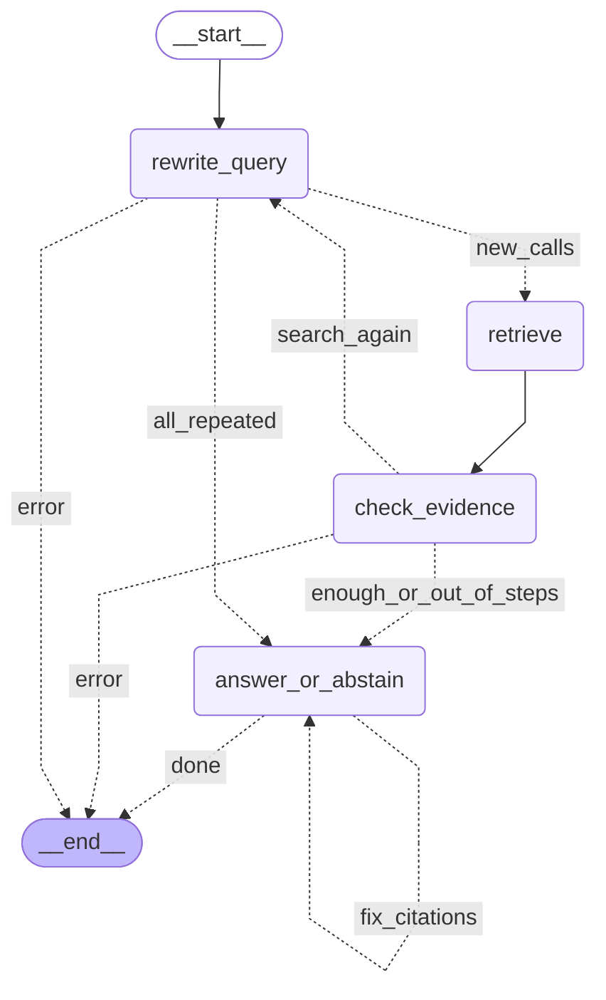

# FDA-Label-Agent

A question-answering agent over FDA drug labels (openFDA, 30 common drugs). It
searches the labels, answers with citations to the exact label passages, and
says so when the labels don't contain the answer. It is built on a hybrid
retrieval pipeline (vector + BM25 + reranker) and compared against a simple
one-shot version of the same pipeline.

> **For information only. Not medical advice.**

## Status

| Part | State |
| --- | --- |
| Data: fetch + parse 30 labels | done |
| Chunking (fixed, section, table-aware) + indexes | done |
| Retrieval evaluation | done, on 24 human-verified questions (`results/retrieval_results.csv`) |
| Single-shot RAG with citations | done; answer-quality evaluation not run yet |
| Agent (LangGraph flow, Gemini adapter, tools) | built and unit-tested; smoke-tested on a few questions only |
| Agent vs single-shot evaluation | **not run yet** |
| API (FastAPI) + Docker | not started |
| Streamlit app | placeholder only |

Best measured retrieval setup so far: section chunks, hybrid search + reranker,
drug filter on: Recall@5 1.0, MRR 0.889 on 21 answerable verified questions
(`results/retrieval_results.csv`, run on 2026-10-05).

## Run it from a fresh clone

Needs Python 3.10+ (developed on 3.14, Windows). The first indexing run
downloads two small models from Hugging Face.

```bash
git clone https://github.com/sruthimundekkottil/FDA-Label-Agent.git
cd FDA-Label-Agent
python -m venv .venv
.venv/Scripts/activate            # Windows; macOS/Linux: source .venv/bin/activate
pip install -r requirements.txt
cp .env.example .env              # then set LLM_MODEL=gemini-3.8-flash and GEMINI_API_KEY
```

Build the data and indexes (nothing under `data/` is in git):

```bash
python -m src.fetch_openfda       # 1. download labels from openFDA -> data/raw/
python -m src.parse_labels        # 2. clean sections             -> data/processed/sections.jsonl
python -m src.chunking            # 3. three chunking strategies  -> data/processed/chunks/
python -m src.indexing            # 4. FAISS + BM25 indexes       -> data/index/
```

Ask the agent:

```bash
python -m agent.loop --query "What are the contraindications of warfarin?"
python -m agent.loop --mock --query "..."    # no API key: offline stand-in model
```

Each run prints the answer, the searches it made and the steps used, and logs
every step to `results/runs/adhoc/agent_log.jsonl`.

Other useful commands:

```bash
python -m src.evaluate_retrieval --verified-only   # retrieval metrics
python -m agent.draw_graph                         # redraw docs/agent_graph.md
pytest                                             # offline tests
```

## How the agent works

The agent answers a question in small steps instead of one big prompt. It is a
graph: four steps connected by arrows, plus rules that decide which arrow to
follow. The diagram below is generated from the code (`python -m agent.draw_graph`).



**The four steps**

1. **Rewrite the question.** The model turns the question into one to three
   searches, using the words a drug label would use and naming the drug.
2. **Retrieve.** The searches run on the same hybrid search and reranker as the
   one-shot pipeline (`search_labels`, `lookup_table` for tables, `get_section`
   to read a whole section). No model is involved in this step.
3. **Check the evidence.** The model reads what was found and decides: "enough
   to answer" or "search again, because X is missing".
4. **Answer or abstain.** The model either gives an answer that cites the label
   passages it used, or says "The provided labels do not contain this information".

**The rules between steps**

- **At most 5 model calls per question.** A new search round only starts if
  there is still room to finish it and answer, so the agent never runs out of
  steps without replying. In practice that allows two search rounds.
- **No repeated searches.** If the model asks for a search it already ran, the
  agent goes straight to answering: the same search can't find anything new.
- **Citations are checked.** Every cited passage must be one the searches
  actually returned. If not, the model gets one chance to fix it.
- **Errors stop the run.** If the model service fails, the run stops and
  records the error rather than guessing.

**Safety and honesty**

- The model is told which 30 drugs are covered; questions about other drugs
  should end in an abstention.
- Label text is shown to the model as quoted data, never as instructions.
- Every model call is recorded, so evaluation runs can be replayed exactly
  without an API key. **A recording only matches the exact request it came
  from: the same instructions, the same tools (names and descriptions) and the
  same settings. Changing any of these, even renaming a tool, means the old
  recordings no longer apply and the run has to be recorded again with the model.**
- Every step and search is logged in a JSONL file.
- LangGraph only decides which step runs next. All model calls go through the
  project's own small adapter (`agent/llm`), so the model provider can be swapped.

## Method notes: chunking and tables

The `fixed` and `section` strategies use **only** plain-text label sections.
`table_aware` adds the label's HTML tables, parsed properly: header rows,
`rowspan`/`colspan` and nested lists are recovered, each row becomes a readable
line (`Adverse reaction: Nausea | Drug: 26% | Placebo: 12%`), and a row is never
split across chunks. Table chunks carry their parent section name, so retrieval
scoring and citations use one section vocabulary.

## Limitations

- **Temperature 0.** Evaluations use temperature 0 so runs can be repeated.
  Google recommends keeping Gemini 3 models at 1.0 and warns that lower values
  can cause looping or weaker reasoning. Results here may differ from the
  model's best settings.
- **Small evaluation set.** 24 questions are human-verified, and only 21 of
  them are answerable (3 test abstention). Differences of one or two questions
  are within noise.
- **Legacy API.** The adapter uses Gemini's `generate_content` API, which Google
  still fully supports but now calls legacy (the newer Interactions API is
  recommended for new projects).
- **Free-tier quota.** The free Gemini tier has a small daily request limit. A
  full evaluation may need more than one day or a paid key. The adapter stops
  immediately when the daily quota is used up, and recordings make reruns free.
- **Agent results not measured yet.** The agent has only been smoke-tested on a
  few questions. No agent-versus-baseline numbers exist yet, and none are
  claimed here.
- One label version per drug; no clinical validation.

## License and disclaimer

MIT (see `LICENSE`). This project uses public openFDA data and is **not** a
medical device, does not provide medical advice, and must not be used to make
clinical decisions.
